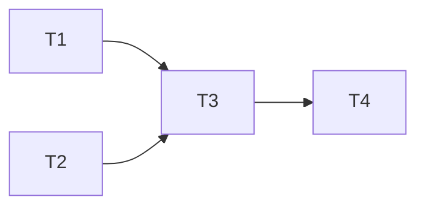

# Tasks: portal do cliente

## Test Coverage Matrix

| Layer | Requirements | Coverage |
| --- | --- | --- |
| Autorização | PORTAL-4,5,8 | JWT real nos dois middlewares, estado da conta e bloqueio de handlers |
| Dados/SQL | PORTAL-1,2,3,4,6,7 | PGlite, marcas e tenants distintos, estados e paginação |
| Integração | PORTAL-1 a PORTAL-10 | Gates completos, revisão independente e mutações em scratch |

## Gate Check Commands

- Quick auth: npx vitest run test/cliente_portal_access.test.js test/auth_session_state.test.js
- Quick dados: npx vitest run test/cliente_portal_revisado*.test.js
- Build: npm test

## Execution Plan

Backend e frontend em branches locais codex/cliente-portal-marca; nenhuma ação remota de escrita. T1 e T2 têm arquivos distintos e podem ocorrer em paralelo. T3 integra seus resultados; T4 revisa o conjunto dos dois repositórios.

## Task Breakdown

### T1: Restringir acesso e perfil do cliente
Depends on: none
Tests: 123 testes focados aprovados de JWT/perfil/rotas e testes unitários do vínculo inequívoco; cenário de token sem sub reproduziu 200 indevido antes da correção
Gate: Quick auth
Done when: PORTAL-4,5,8 atendidos no limite da API sem alterar papéis internos.
Status: complete
Owner: root

### T2: Consultar somente resultados revisados da marca
Depends on: none
Tests: mocks e PGlite para PORTAL-1,2,3,4,6,7
Gate: Quick dados
Done when: as três rotas reutilizam identidade/filtro/DTO seguro e o contrato alinhado com a UI.
Status: in progress
Owner: backend_portal

### T3: Integrar contratos e preparar entrega local
Depends on: T1, T2
Tests: regressão completa, runner de migrations sem migrations novas e runbook de publicação/rollback
Gate: Build
Done when: npm test verde, testes legados alinhados à regra aprovada e nenhum cache Graft no diff.
Status: pending
Owner: root

### T4: Verificar isolamento independentemente
Depends on: T3
Tests: revisão dos dois repositórios e pelo menos cinco mutações em cópias descartáveis
Gate: Build
Done when: validation.md com evidências, sensores mortos e validação determinística PASS.
Status: pending
Owner: verifier
